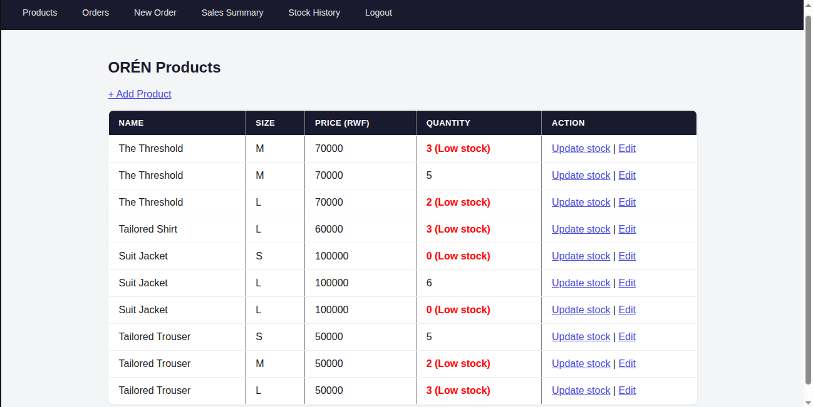
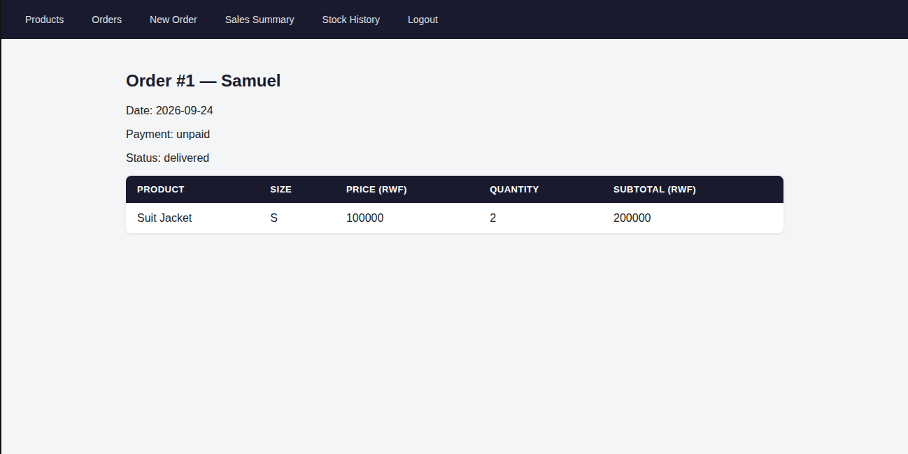
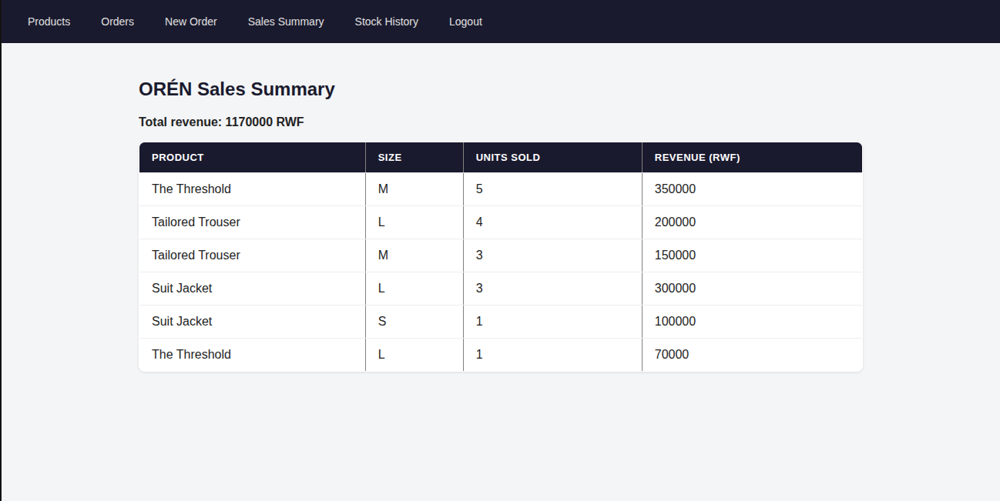

# ORÉN Order & Inventory Tracker

A web app for ORÉN RWANDA LTD to track stock, record customer orders, and follow payment and fulfillment status.

## Problem
ORÉN's orders and stock were tracked in WhatsApp chats and from memory, which caused missed orders, overselling, and payments that couldn't be matched to an order.

## Tech stack
Python (Flask), SQLite, HTML/CSS, Flask-Login

## Features
- Admin login (password stored outside the repo in a `.env` file)
- Products: add, edit, update stock, and delete (deleting is blocked if the product is in an existing order)
- Low-stock flagging for items under 5 units
- Multi-item orders with automatic stock reduction
- Checks that block overselling, zero or negative quantities, and the same product repeated across rows
- Order status (new, packed, delivered) and payment status (paid, unpaid)
- Payment reference (for example the MoMo transaction ID) saved on each order
- Order detail page with items, prices, and subtotal
- Order cancellation that returns stock (blocked for delivered orders)
- Search orders by customer name, and a customer order history page
- Sales summary showing revenue from paid orders only, and units sold per product
- Stock history log recording every stock change with its date and reason

## Status
Core features are built and tested locally with real ORÉN products and orders. Not deployed yet.

## Screenshots

**Products, with low-stock flags**

**Order detail**

**Sales summary (paid orders only)**

## Testing
Testing was done by hand against real data, and it found and fixed these bugs:
- Orders could sell more than was in stock
- An order could be saved with zero items
- Deleting a product silently erased the contents of orders that included it
- The same product repeated in one order bypassed the stock check
- The sales summary counted unpaid orders as revenue

## Known limitations and next steps
- No live MoMo integration: the admin marks orders as paid by hand
- CSRF protection is not added yet
- Feedback from real use at ORÉN is still to come

## Documentation
A step-by-step guide is in [USER_GUIDE.md](USER_GUIDE.md).

## Setup
1. Clone the repo:
   `git clone https://github.com/Nziza21/oren-order-inventory-tracker.git` then `cd oren-order-inventory-tracker`
2. Create and activate a virtual environment:
   `python3 -m venv venv` then `source venv/bin/activate` (on Windows: `venv\\Scripts\\activate`)
3. Install the packages: `pip install -r requirements.txt`
4. Create a file called `.env` in the project folder with two lines:
   `ADMIN_PASSWORD=choose-a-password`
   `SECRET_KEY=any-long-random-text`
   To generate a key: `python3 -c "import secrets; print(secrets.token_hex(32))"`
5. Create the database with sample products (run this once): `python3 init_db.py`
6. Start the app: `python3 app.py`
7. Open http://127.0.0.1:5000/login and log in with the password from your `.env`
